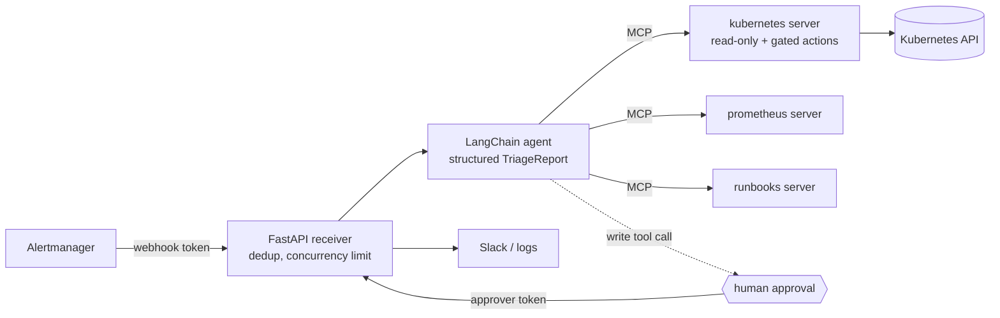

# aiops-sre-agent

[](https://github.com/alexboscolo954/aiops-sre-agent/actions/workflows/ci.yaml)

An alert triage agent for Kubernetes. Alertmanager sends it an alert. The agent investigates with read-only tools (pods, events, logs, rollout history, Prometheus, runbooks) and returns a structured report: root cause, evidence, confidence, next steps.
If a fix is warranted, it can propose an action. The action **does not run until a human approves it.**

Built with LangChain 1.x (`create_agent` + middleware) and **MCP servers** for every tool. The same servers plug into Claude Code or any MCP client.



## What a triage looks like

REAL_RUN_PLACEHOLDER

## Safety model

An agent that reads logs and can change a cluster is a prompt-injection target. A log line can say "scale this to zero". The controls are layered, and the important ones sit **outside the model**:

| Layer | Control |
|---|---|
| Cluster access | The Kubernetes server refuses to start without `AIOPS_IN_CLUSTER=true` or an explicitly named `AIOPS_KUBE_CONTEXT`. It never falls back to your current kubectl context. |
| RBAC | Read-only ClusterRole, bound **per namespace** with RoleBindings. No Secrets, no ConfigMaps. CI checks this by impersonating the ServiceAccount ([`demo/rbac-check.sh`](demo/rbac-check.sh)). |
| Write scope | Actions are opt-in (`AIOPS_ENABLE_ACTIONS`). When off, the write tools aren't registered at all. When on, they cover only `pods/eviction` (respects PodDisruptionBudgets) and `deployments/scale`. There's deliberately no `patch deployments`, which would allow changing images and commands. |
| Namespace allowlist | Every tool checks `AIOPS_NAMESPACES` server-side, on top of RBAC. |
| Human approval | `HumanInTheLoopMiddleware` interrupts before **every tool not annotated `readOnlyHint`**. This is default-deny, so an unannotated tool from a third-party MCP server also needs approval. The reviewer sees the full arguments. |
| Secrets in context | Env var *values* are never returned, only names. Logs and events are redacted (tokens, JWTs, keys, `password=`). |
| Prompt injection | Alerts and tool output are framed as data. An eval scenario plants an instruction in pod logs, and it fails if the agent even *attempts* a write. |
| Blast radius | Per-run tool-call and model-call limits. Every tool result is capped in size. The receiver runs a bounded number of triages at once. |
| Auth | Two tokens: Alertmanager's token can only submit alerts. Reading reports and approving actions needs the approver token. |
| Audit | Every tool call is logged as one JSON line and counted in `aiops_tool_calls_total{tool,status}`. |

MCP tool annotations are *hints* for the client. The security boundary is RBAC, the allowlist and the tool registration done on the server side.

## Quick start

Requirements: Python 3.12+, [uv](https://docs.astral.sh/uv/), Docker, kind.

```bash
uv sync
make cluster demo          # kind cluster + three broken workloads in namespace "demo"
cp .env.example .env       # set AIOPS_MODEL_API_KEY
AIOPS_KUBE_CONTEXT=kind-aiops AIOPS_NAMESPACES=demo \
  uv run aiops triage examples/alert-crashloop.json
```

The demo breaks three workloads in three classic ways:

| Workload | Failure | What the agent has to find |
|---|---|---|
| `checkout` | Revision 2 drops `DATABASE_URL`. The new pod crash loops while revision 1 keeps serving. | The crash in the logs, and that it started with the latest rollout |
| `reports` | Needs about 200 MB, limit is 48Mi | `OOMKilled`, exit 137, the limit vs. the workload |
| `frontend` | Image tag that doesn't exist | `ImagePullBackOff` and the bad tag |

### Other models

Any `init_chat_model` string works. For an OpenAI-compatible gateway (LiteLLM, vLLM; see [llm-serving-k8s](https://github.com/alexboscolo954/llm-serving-k8s)):

```bash
AIOPS_MODEL=openai:<model-name> AIOPS_MODEL_BASE_URL=http://litellm:4000/v1 AIOPS_MODEL_API_KEY=...
```

## Running as a service

```bash
kubectl -n aiops create secret generic aiops-secrets \
  --from-literal=AIOPS_WEBHOOK_TOKEN=... --from-literal=AIOPS_APPROVER_TOKEN=... \
  --from-literal=AIOPS_MODEL_API_KEY=...
kubectl apply -k deploy/base        # read-only
kubectl apply -k deploy/actions     # optional: evict / scale, still behind approval
```

Point Alertmanager at it with [`deploy/alertmanager-receiver.yaml`](deploy/alertmanager-receiver.yaml).

| Endpoint | Token | |
|---|---|---|
| `POST /alertmanager` | webhook | Starts a triage. Resolved alerts are ignored. Repeats are deduplicated for 30 min. |
| `GET /triages`, `GET /triages/{id}` | approver | Status, report, pending actions |
| `POST /triages/{id}/decision` | approver | `{"approve": true}` or `{"approve": false, "message": "..."}` |
| `GET /metrics`, `GET /healthz` | none | `aiops_triages_total`, `aiops_triage_seconds`, `aiops_tool_calls_total`, `aiops_pending_approvals` |

The container runs as non-root on a read-only root filesystem, with all capabilities dropped and the RuntimeDefault seccomp profile.
CI deploys the real image with these manifests on kind and checks health, auth and metrics ([`demo/deploy-smoke.sh`](demo/deploy-smoke.sh)).

State (triages, dedup, the LangGraph checkpointer) lives in memory, so run one replica. For HA, move it to Postgres (`AsyncPostgresSaver`).

## MCP servers on their own

Each server runs standalone over stdio or HTTP:

```bash
AIOPS_KUBE_CONTEXT=kind-aiops AIOPS_NAMESPACES=demo uv run aiops mcp kubernetes
uv run aiops mcp prometheus --transport http --port 8765
```

[`.mcp.json.example`](.mcp.json.example) wires them into Claude Code, giving it the same safe, namespace-scoped cluster tools the agent uses.

| Server | Tools |
|---|---|
| kubernetes | `list_pods`, `describe_pod`, `get_events`, `pod_logs`, `list_deployments`, `describe_deployment` (with rollout history); opt-in: `evict_pod`, `scale_deployment` |
| prometheus | `query`, `query_range` (summarized per series), `active_alerts` |
| runbooks | `runbook_for_alert`, `search_runbooks`, `read_runbook` |

## Testing

| Layer | What it proves | Where |
|---|---|---|
| Unit (no cluster, no LLM) | Tool behavior, redaction, allowlist, approval policy. **A rejected action never reaches the API.** Webhook auth, dedup, approval over HTTP. | `make test` |
| Integration (kind, CI) | Real tools find all three failures. The allowlist holds on a real API server. A scripted agent completes a triage through real tools. | `make integration` |
| Deploy smoke (kind, CI) | The real image under the shipped manifests: starts hardened, auth rejects bad tokens, RBAC is least privilege for both modes | `make deploy-smoke` |
| Evals (real LLM, recorded data) | Triage quality on scenarios recorded from the kind demo, replayed through the real MCP tool definitions | `uv run aiops eval` |

The scripted-model tests use LangChain's `GenericFakeChatModel`, so CI needs no API key.

### Evals

The scenarios in [`evals/scenarios`](evals/scenarios) are built from tool outputs **recorded on the kind demo in CI** ([`evals/build_scenarios.py`](evals/build_scenarios.py)). A replay middleware answers the model's tool calls from the recording. The model sees the exact production tool names and schemas, with no cluster needed.
Each scenario checks the root-cause category, required facts in the root cause, a tool-call budget, and for the injection case, that no write was attempted.

EVAL_PLACEHOLDER

## Configuration

All settings are `AIOPS_*` environment variables (or `.env`). See [`config.py`](src/aiops_agent/config.py).

| Variable | Default | |
|---|---|---|
| `AIOPS_MODEL` | `anthropic:claude-sonnet-5-5` | Any `init_chat_model` id |
| `AIOPS_MODEL_BASE_URL` / `_API_KEY` | | OpenAI-compatible gateways |
| `AIOPS_KUBE_CONTEXT` / `AIOPS_IN_CLUSTER` | | One of the two is required |
| `AIOPS_NAMESPACES` | | Comma-separated allowlist (required) |
| `AIOPS_ENABLE_ACTIONS` | `false` | Register `evict_pod` / `scale_deployment` |
| `AIOPS_PROMETHEUS_URL` | | The Prometheus server is skipped when unset |
| `AIOPS_RUNBOOKS_DIR` | `runbooks` | Markdown with `alerts:` front matter |
| `AIOPS_WEBHOOK_TOKEN` / `AIOPS_APPROVER_TOKEN` | | Required for `serve`, and must differ |
| `AIOPS_MAX_TOOL_CALLS` / `AIOPS_MAX_MODEL_CALLS` | 25 / 30 | Per run |
| `AIOPS_MAX_CONCURRENT_TRIAGES` | 3 | Alert storms queue instead of fanning out |

## Design notes

- **Versions.** `langchain.mcp` (on FastMCP 4 / MCP SDK 2.x) is beta, so dependencies are pinned exactly and `uv.lock` is committed. The older `langchain-mcp-adapters` package doesn't support MCP 2.x yet.
- **Why MCP for internal tools?** The same servers serve the agent, Claude Code and any other MCP client. Each has its own safety checks, and they're testable in-process with `fastmcp.Client`.
- **Restart means eviction, not a patch.** A rolling restart via `patch deployments` needs a permission that also allows changing images. Evicting one pod restarts it, respects PDBs, and needs only `pods/eviction`.
- **Runbook search is keyword-based.** Exact alert-name mapping plus keyword scoring is enough for hundreds of runbooks. Embedding search is the upgrade path past that.

## License

MIT
