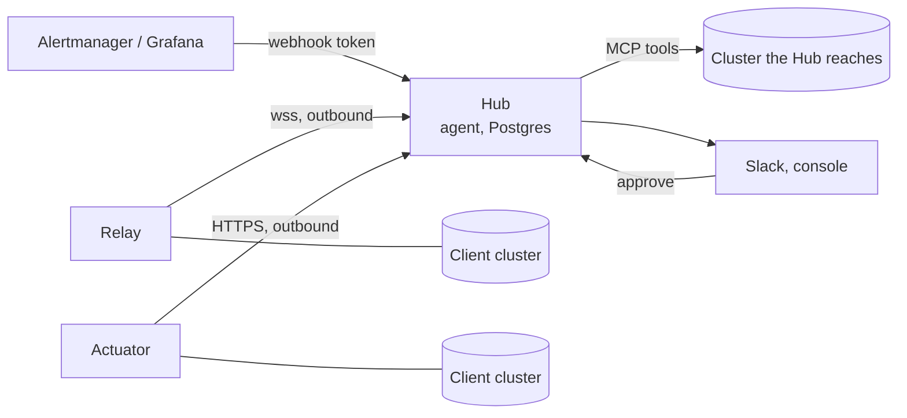

<p align="center">
  <picture>
    <source media="(prefers-color-scheme: dark)" srcset="docs/assets/logo-dark.svg">
    
  </picture>
</p>

# squero

[](https://github.com/alexboscolo954/squero/actions/workflows/ci.yaml)

An SRE Hub for Kubernetes that serves several clients at once. Each client is a **Contract**: its clusters, integrations, Slack channel and secrets, kept apart from every other client's.

- **Triage.** Alertmanager or Grafana sends an alert group (one notification holding one or more alerts). An agent investigates with read-only tools (pods, events, logs, rollout history, recent changes, Prometheus, runbooks, the clouds) and returns a structured Report: root cause, evidence, confidence and recommendations for the on-call engineer.
- **Resource optimizer.** The Hub reads each cluster's usage, sizes every container, prices it, and reports waste, cost by team, and Savings, checked against the cloud bill.
- **Changes wait for a human.** A fix is only ever a *Proposed action*, and it **does not run until a human approves it**. It is rejected automatically if nobody decides in time or the alert group resolves first.

Three parts, all from one image:

| Part | Where it runs | What it does |
|---|---|---|
| **Hub** | A machine you own (compose stack) | Takes alerts, runs the agent, stores everything in Postgres, talks to Slack, serves the web console and an MCP server |
| **Relay** (optional) | Inside a client's cluster | For a cluster the Hub can't reach: carries the Hub's reads and the cluster's alerts over an outbound websocket |
| **Actuator** (optional) | Inside a client's cluster | Applies the Sizings you approved, in place, and rolls one back if it hurt the pods |



Built with LangChain 1.x (`create_agent` + middleware) and **MCP servers** for every tool; the same servers plug into Claude Code or any MCP client. The terms are defined in [`CONTEXT.md`](CONTEXT.md).

## What a triage looks like

Real output from `claude-sonnet-5-5` on tool outputs recorded from the kind demo, where a rollout dropped `DATABASE_URL`. It took 4 tool calls in about 11 s.

> ## The checkout pod checkout-7c856f898c-bjtfx (revision 2) is crash looping because it starts without the DATABASE_URL env var. Revision 1 had that variable and its pod is still healthy.
>
> **Root cause** (high confidence, `bad_rollout`): Deployment revision 2 (ReplicaSet checkout-7c856f898c) dropped the DATABASE_URL env var that revision 1 defined. The app exits with code 1 at startup because the variable is missing.
> **Severity:** medium  ·  **Affected:** demo/Deployment/checkout, demo/Pod/checkout-7c856f898c-bjtfx
>
> **Recommendations**
> 1. Roll back the checkout deployment to revision 1 (kubectl rollout undo deployment/checkout -n demo), or re-add DATABASE_URL to the pod template (from a Secret or ConfigMap).
> 2. Find out why the env var was removed in the latest change to the manifest or Helm values, and fix it at the source so it is not re-applied.
> 3. Add a CI check or startup validation so a rollout that lacks required config fails before it replaces healthy pods.
> 4. Don't restart the pod. A restart will not fix a missing env var.

The full Report, its evidence and the other Scenarios are in [docs/development.md](docs/development.md#what-a-triage-looks-like).

## Safety in brief

The controls that matter sit **outside the model**. The full table is in [docs/safety.md](docs/safety.md).

- **Read-only by default.** RBAC is a read-only ClusterRole bound per namespace, with no Secrets and no ConfigMaps.
- **Writes are opt-in and narrow.** Pod eviction and deployment scale only, per Contract. There is no `patch deployments`, so nothing can change an image or a command.
- **Every write waits for a human.** The Hub keeps its own list of reads and writes; a tool not on it is hidden.
- **Clients stay apart.** Every tool checks its cluster and namespace against its own Contract, on top of RBAC.
- **Secrets never reach the model.** Env var values, tokens and keys are redacted, and a Contract can mask its hostnames, names, emails and IPs.
- **Prompt injection is tested.** An eval plants an instruction in pod logs and fails if the agent even attempts a write.
- **The Actuator only resizes.** Requests only, never above the limit, nothing while the Kill switch is on, and its webhook fails open. A memory limit is raised only by a Reflex the Contract switches on, within its bound ([ADR 0005](docs/adr/0005-reflexes-may-raise-limits.md)).

## Quick start

Requirements: Python 3.12+, [uv](https://docs.astral.sh/uv/), Docker, kind.

```bash
uv sync
make cluster demo          # kind cluster + three broken workloads in namespace "demo"
cp .env.example .env       # set SQUERO_MODEL_API_KEY; SQUERO_CONTRACTS_DIR=demo/contracts
export SOPS_AGE_KEY="$(cat demo/contracts/test-keys/*.agekey)"   # the demo's public test keys
uv run squero triage examples/alert-crashloop.json --contract demo-shop
```

The demo breaks three workloads in three classic ways:

| Workload | Failure | What the agent has to find |
|---|---|---|
| `checkout` | Revision 2 drops `DATABASE_URL`. The new pod crash loops while revision 1 keeps serving. | The crash in the logs, and that it started with the latest rollout |
| `reports` | Needs about 200 MB, limit is 48Mi | `OOMKilled`, exit 137, the limit vs. the workload |
| `frontend` | Image tag that doesn't exist | `ImagePullBackOff` and the bad tag |

To run it for real, start with [Running the Hub](docs/running-the-hub.md).

## Documentation

| Document | What it covers |
|---|---|
| [Running the Hub](docs/running-the-hub.md) | The compose stack, Slack, the web console, the Hub MCP server, one-cluster mode, models and cost, every `SQUERO_*` setting |
| [Contracts](docs/contracts.md) | The Contract file: layout and secrets, Masking, GitOps, Jira, Checks, Teachings, vendor integrations, Azure, Google Cloud, AWS |
| [Resource optimizer](docs/optimizer.md) | Sizings, policies, prices, the Bill check, cost by team, Savings, the weekly digest, the lab |
| [The client's cluster](docs/client-cluster.md) | The Relay and the Actuator: what each one may do and how to install it |
| [Safety model](docs/safety.md) | Every layer of control, in full |
| [Development](docs/development.md) | Tests, evals, the MCP servers on their own, design notes |
| [`CONTEXT.md`](CONTEXT.md) | The vocabulary |
| [`AGENTS.md`](AGENTS.md) | How to change this repository (for people and AI agents) |
| [Roadmap](docs/roadmap.md) | What is built, what is next, and every decision |

## License

squero is source-available under the [PolyForm Noncommercial License 1.0.0](LICENSE): free for personal use, research, education and noncommercial organizations. Any commercial use needs written permission from the author. Releases up to v0.37.0 were published under MIT and stay under MIT.

The name "squero" and the ferro logo are trademarks: a fork must use its own name and logo. See [TRADEMARKS.md](TRADEMARKS.md).

Outside pull requests are not accepted; issues are welcome ([CONTRIBUTING.md](CONTRIBUTING.md)).
